# Example results

These are unedited results from finished reviews. Click any figure to enlarge
it. To learn how to read a timeline, see
[Step 7 of the tutorial](tutorial.md#the-timeline). The requests behind several
of these reviews are on [Example requests](requests.md).

Every review produces a spreadsheet and, unless you skip it, a timeline. A
written review is optional. The [tutorial](tutorial.md#the-spreadsheet) shows
rows from a real spreadsheet.

## Timelines

Each timeline below comes from a different review. Each lane is a family of
papers that share a claim, and each dot is one paper.

### Differences across cortical layers

<figure class="fig" markdown>
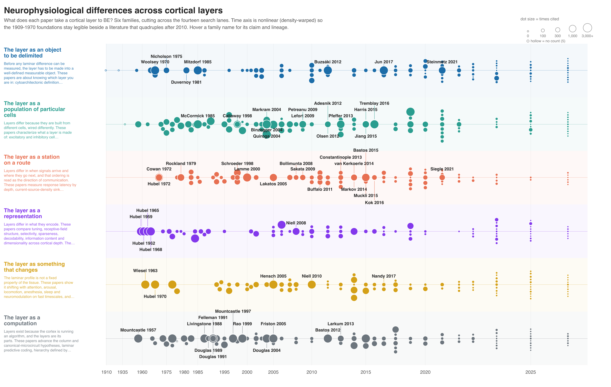{ loading=lazy }
<figcaption markdown>
**Six answers to the question "what is a cortical layer?"** 555 papers,
1909–2026. The families treat a layer as a boundary to measure, a population of
cells, a station on a signal's route, a representation, something that changes,
or a step in a computation. The "representation" lane rests on Hubel and
Wiesel's work from 1959 to 1968; most of the "something that changes" lane is
recent. [Request](requests.md#differences-across-cortical-layers).
</figcaption>
</figure>

### Creatine deficiency

<figure class="fig" markdown>
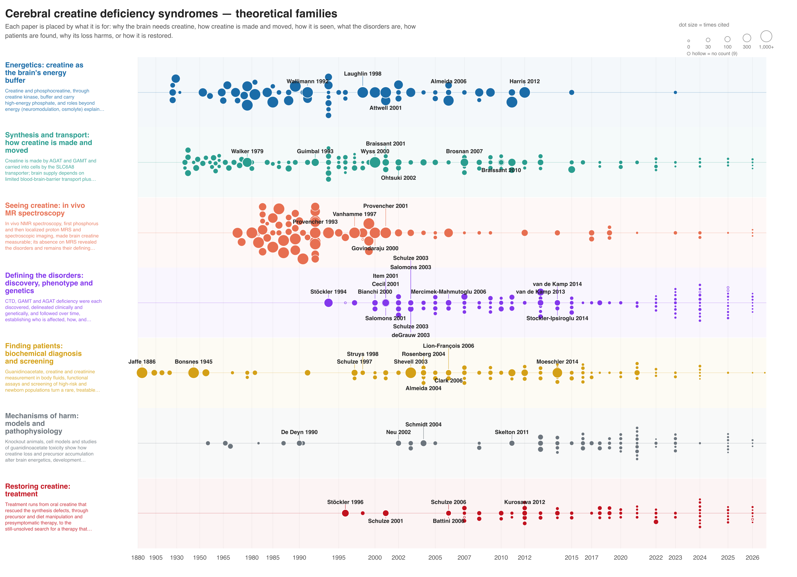{ loading=lazy }
<figcaption markdown>
**From the chemistry of creatine to the search for a treatment.** 587 papers,
1886–2026. The families run from energy metabolism, synthesis and imaging,
through defining the disorders and finding patients, to how the loss harms the
brain and how to restore it. Most imaging papers date from 1980–2000, while the
treatment lane is still growing. [Request](requests.md#creatine-deficiency).
</figcaption>
</figure>

### How the brain represents complexity

<figure class="fig" markdown>
{ loading=lazy }
<figcaption markdown>
**Six answers to "what is complexity?"** 190 papers, 1948–2026. The families
treat complexity as information, redundancy to compress, hierarchy,
representational geometry, bounded capacity, or integrated information. Three of
them rest on landmarks from the 1950s; the geometry lane starts in the mid-2000s.
</figcaption>
</figure>

### The cognitive map

<figure class="fig" markdown>
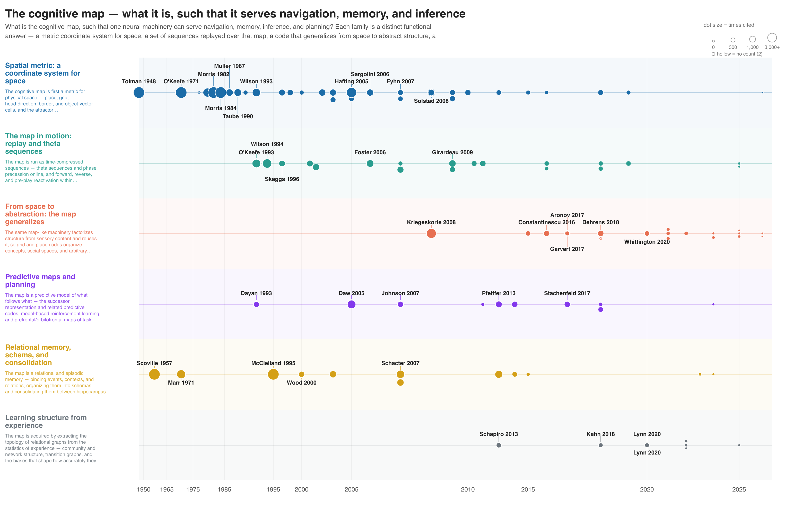{ loading=lazy }
<figcaption markdown>
**Six accounts of what the brain's map is for.** 110 papers, 1948–2026. The
families treat the map as a spatial metric, replayed sequences, abstract
structure, prediction and planning, relational memory, or structure learned from
experience. Maps of abstract, non-spatial structure appear only from 2008.
</figcaption>
</figure>

### World models

<figure class="fig" markdown>
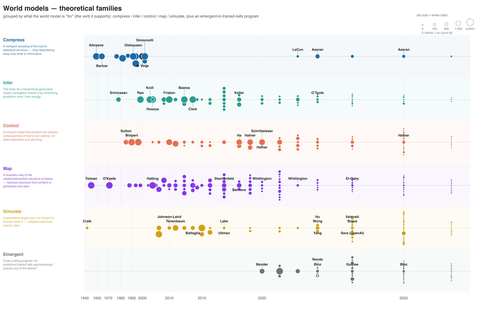{ loading=lazy }
<figcaption markdown>
**Six things a world model can do.** 348 papers, 1943–2026. The families are
named for what the model does: compress, infer, control, map, simulate, or emerge
in trained networks. The compression lane is almost all before 2005; the
simulation and emergence lanes are densest in 2023–2025.
</figcaption>
</figure>

### Concepts in the brain

<figure class="fig" markdown>
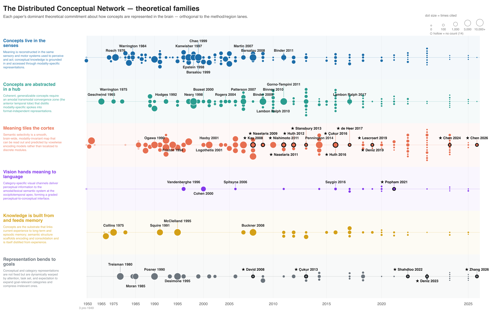{ loading=lazy }
<figcaption markdown>
**Six accounts of where concepts are stored.** 450 papers, 1950–2026. Concepts
live in sensory and motor systems, in a central hub, in a map across cortex,
in a handoff from vision to language, in memory, or shaped by goals. Papers from
the home lab, marked with stars, cluster in the "map across cortex" lane.
</figcaption>
</figure>

### Data structures in the brain

<figure class="fig" markdown>
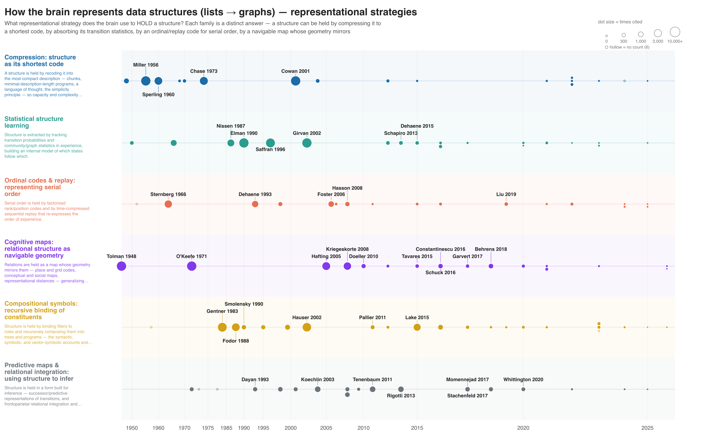{ loading=lazy }
<figcaption markdown>
**Six strategies for holding a structure in mind.** 117 papers, 1948–2026.
Compression, statistical learning, codes for order, cognitive maps, symbols that
combine, and predictive maps. Each strategy has roots between 1948 and 1990; the
cognitive-map lane grows fastest after 2005.
</figcaption>
</figure>

### The evolution of the language network

<figure class="fig" markdown>
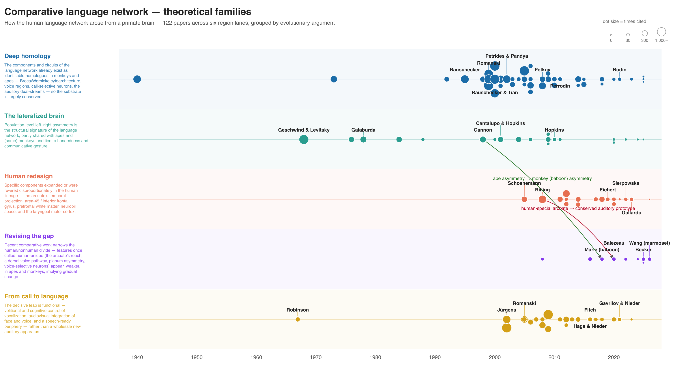{ loading=lazy }
<figcaption markdown>
**Five arguments for how language arose from a primate brain.** 122 papers,
1940–2026. The two arrows were added by hand: each links an old claim that a
feature is uniquely human to a recent paper that found it in monkeys. Every
paper in the "revising the gap" lane dates from 2008 or later.
</figcaption>
</figure>

### Brain recordings during conversation

<figure class="fig" markdown>
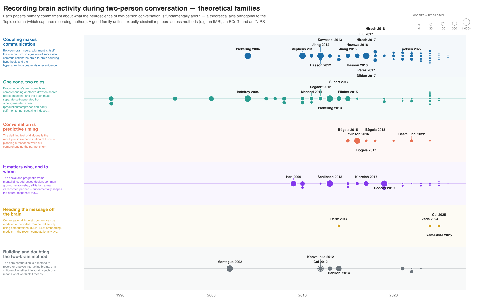{ loading=lazy }
<figcaption markdown>
**Six views of what the neuroscience of dialogue studies.** 131 papers,
1989–2025. Coupling between two brains, shared codes for speaking and listening,
turn timing, social context, decoding the message, and recording two brains at
once. Nearly all of it is from after 2004, and the decoding lane holds only four
papers.
</figcaption>
</figure>

## A lab review

A lab review starts from one lab's publications instead of a question. It groups
the lab's work into themes, then searches outward to place each theme in its
field. This one began with the request *"review the Gallant lab's human-imaging
work in the context of the broader field."*

<figure class="fig" markdown>
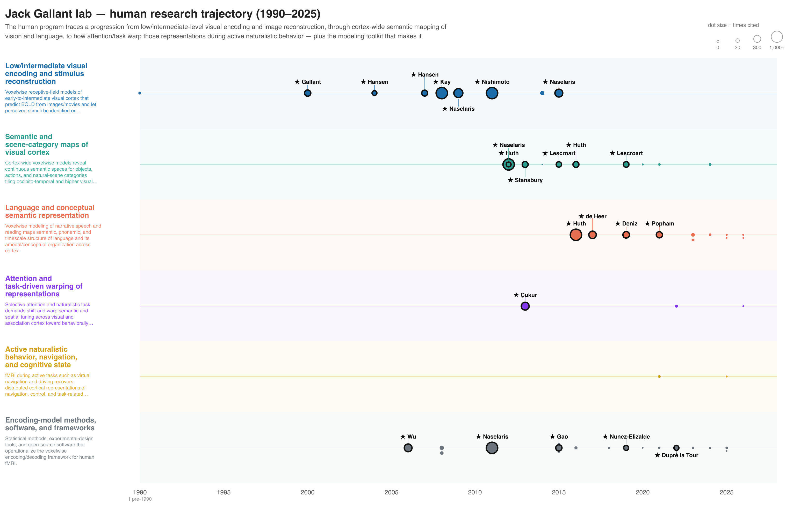{ loading=lazy }
<figcaption markdown>
**First, the lab's own work.** 61 human-imaging papers from the Gallant lab,
1990–2025, in six themes. Every dot is a lab paper, so every dot carries a star.
The work moves from visual encoding (2000–2015) to meaning in visual cortex
(from 2012) and then to language (from 2016).
</figcaption>
</figure>

<figure class="fig" markdown>
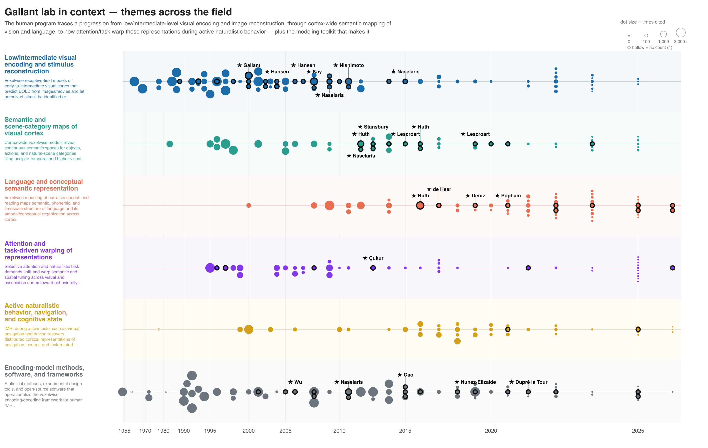{ loading=lazy }
<figcaption markdown>
**Then, the same themes in their fields.** 287 papers from other groups added
around 72 lab papers, 359 in all. Starred dots are the lab's. In visual encoding,
the lab's papers sit inside a literature that began decades earlier; in language,
most of the field's papers came after the lab's 2016 landmark.
</figcaption>
</figure>

## A written review

When you ask for one, the agent drafts a written review from the papers'
abstracts. These pages come from the review of how the brain represents
complexity.

<figure class="fig" markdown>
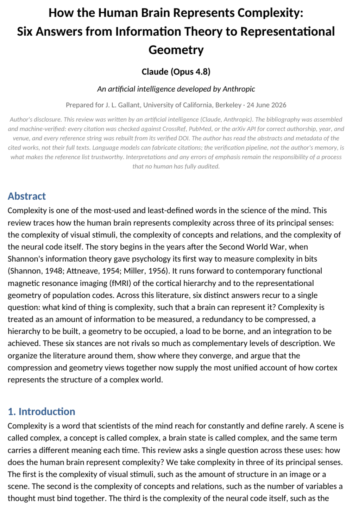{ loading=lazy }
<figcaption markdown>
**The title page says who wrote the review and how it was checked.** The author
block names the AI model. The disclosure says every citation was checked by
machine, every reference was rebuilt from its DOI, and the summaries come from
abstracts, not full texts.
</figcaption>
</figure>

<figure class="fig" markdown>
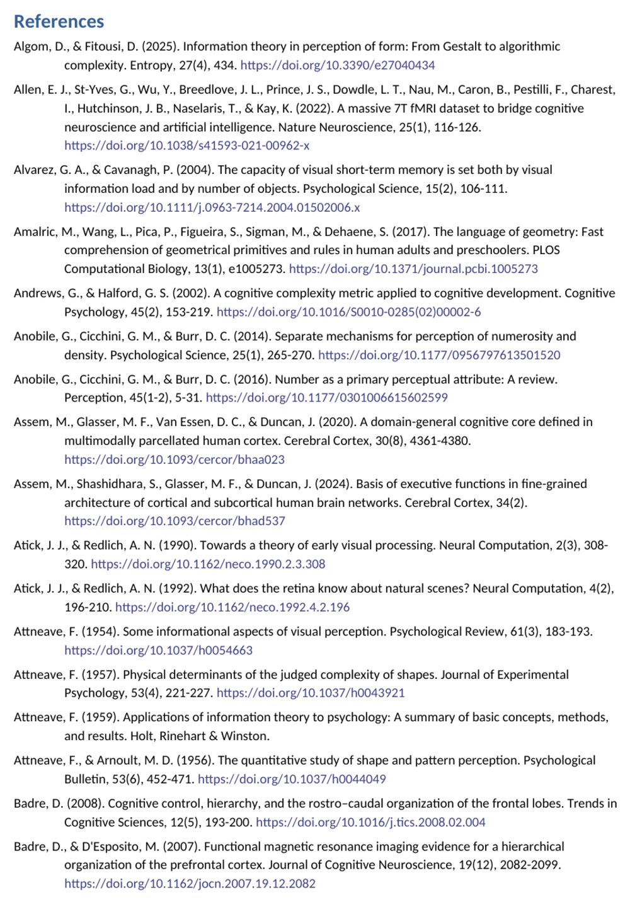{ loading=lazy }
<figcaption markdown>
**The reference list is generated from the checked papers, not typed.** Each
entry has its full author list, its title in sentence case and a DOI link, in
APA order. The one entry without a link is a book with no DOI.
</figcaption>
</figure>

