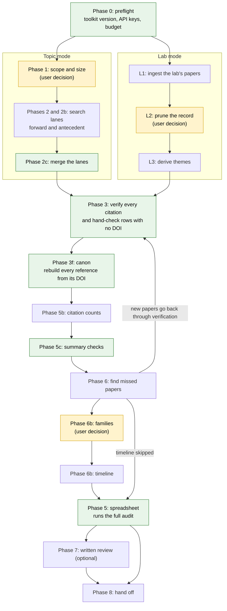

# How it works

This part of the site is for developers: anyone who runs the phases by hand,
changes a tool, or adds one. It describes the procedure the agent follows, which
[`PLAYBOOK.md`](https://github.com/gallantlab/literature-review-toolkit/blob/main/PLAYBOOK.md)
states for the agent, and gives the reason behind each gate. To run a review
without touching the internals, use the [Tutorial](tutorial.md) instead.

| Page | Covers |
|---|---|
| How it works (this page) | the design, the pipeline, the rules, the files, limits and timing |
| [Searching](search.md) | the preflight, scope, search lanes, the merge, lab mode |
| [Checking](checks.md) | verification, hand checks, canon, citation counts, summary checks, missed papers, acknowledgments |
| [Deliverables](deliverables.md) | families and the timeline, the spreadsheet, PDFs, the written review, hand-off |
| [Reruns and upgrades](reruns.md) | adding papers, re-rendering, upgrading an old corpus |
| [Troubleshooting](troubleshooting.md) | failures and their fixes |
| [Tools reference](tools.md) | every script and flag |

## The design

A literature review mixes two kinds of work. A few steps need judgment: what to
search, how to group the papers, how to write them up. Everything else has a
ground truth: a DOI either resolves to the cited paper or it does not.

The toolkit separates the two. **The agent supplies judgment; the scripts supply
ground truth.** A script checks every checkable fact, behind a gate that stops
the review rather than let an error through. Without a duty to verify, search
agents got about 1 in 4 citations wrong: they invented DOIs, swapped first
authors, inverted findings, and attached the wrong author list to a real paper.
Every search brief now carries that duty, and nothing downstream trusts an
unverified reference. Summaries are checked the same way, against each paper's
abstract.

**Size.** The user sets the size of the search, from a quick scan to an
exhaustive one ([Set the scope and size](search.md#set-the-scope-and-size-phase-1)).
Every check runs at every size. Reviews so far have run from about 50 to over
1,100 papers. Above about 110 papers, several timeline defaults need retuning
([Tune the timeline](deliverables.md#tune-the-timeline-for-a-large-corpus)).

## The pipeline



<small>**Two front ends feed one checked backbone.** Topic mode starts from a
question; lab mode starts from a lab's publications. Yellow boxes are user
decisions. Green boxes are gates: each one stops the review on an error. Papers
found in Phase 6 loop back through verification, so no reference reaches a
deliverable unchecked. The spreadsheet keeps its playbook number (Phase 5) but
runs last, because it is the release gate.</small>

### The order the agent runs

Phase numbers come from the playbook, so they do not follow the run order. This
is the order, with the steps that can run at the same time.

| # | Step | Phase | Tools | Details |
|---|---|---|---|---|
| 1 | Run the preflight | 0 | `preflight.py` | [Searching](search.md#run-the-preflight-phase-0) |
| 2 | Agree on the scope and size with the user | 1 | — | [Searching](search.md#set-the-scope-and-size-phase-1) |
| 3 | Write the lane spec, render the briefs, run every lane | 2, 2b | `lane_briefs.py` | [Searching](search.md#write-the-lane-spec-phase-2) |
| 4 | Merge the lanes | 2c | `merge_lanes.py` | [Searching](search.md#merge-the-lanes-phase-2c) |
| 5 | Verify every row; hand-check rows with no DOI | 3, 3e | `verify.py`, `handcheck.py` | [Checking](checks.md#verify-every-citation-phase-3) |
| 6 | Propose the families to the user | 6b | `families.py --digest` | [Deliverables](deliverables.md#families-and-the-timeline-phase-6b) |
| 7 | Run canon; at the same time, fetch counts, cross-references and abstracts | 3f, 5b, 6, 5c | `references.py`, `citations.py`, `xref.py`, `abstracts.py` | [Checking](checks.md#rebuild-every-reference-phase-3f) |
| 8 | Attach the counts, then run the forward search | 5b, 6 | `citations.py --attach-only`, `forward.py` | [Checking](checks.md#find-missed-papers-phase-6) |
| 9 | Decide every candidate; send the included ones back through steps 5 and 7 | 6 | `candidates.py`, `merge_lanes.py --append` | [Checking](checks.md#decide-the-candidates) |
| 10 | Sentence-case the titles, in a reviewed pass | 3f | `sentence_case.py` | [Checking](checks.md#sentence-case-the-titles) |
| 11 | Check every summary against its abstract | 5c | `summary_audit.py` | [Checking](checks.md#check-every-summary-phase-5c) |
| 12 | Assign the families and render the timeline | 6b | `families.py`, `families_figure.py` | [Deliverables](deliverables.md#families-and-the-timeline-phase-6b) |
| 13 | Acknowledge each remaining warning | — | `references.py --list-acks` | [Checking](checks.md#acknowledge-warnings) |
| 14 | Build the spreadsheet | 5 | `spreadsheet.py` | [Deliverables](deliverables.md#build-the-spreadsheet-phase-5) |
| 15 | Write the review, if asked | 7 | `cite_check.py`, `review_paper.py` | [Deliverables](deliverables.md#write-the-review-phase-7) |
| 16 | Hand off | 8 | — | [Deliverables](deliverables.md#hand-off-phase-8) |

Step 7's tools share one Semantic Scholar key, and a shared pacer keeps them from
drawing each other's rate limits ([Environment variables](#environment-variables)).

## The decisions that belong to the user

| Decision | Phase | Why it belongs to the user |
|---|---|---|
| **Scope and size**: the topic and its span, or which lab; how big a search | 1, L1–L2 | Only the user knows the question and how much of the field they need |
| **Families and the timeline** | 6b | The agent offers the timeline on every review and proposes its families; the user accepts, changes or skips them |
| **The write-up** (optional) | 7 | Prose is judgment; the toolkit does not fake it |

When API access is short, the preflight adds a fourth: how the review proceeds
([Run the preflight](search.md#run-the-preflight-phase-0)).

## The rules

The agent follows ten rules. The other pages explain each one.

| # | Rule | Phase |
|---|---|---|
| 0 | **Check for a newer toolkit and for API access before any search.** When `preflight.py` exits 2, stop. Offer the newer version, if there is one. When access is short, the user chooses: get the keys, cap the search, or wait. The merge refuses to run until the record is cleared. | 0 |
| 1 | **Verify every citation** before it enters a deliverable, preprints included. `verify.py --rows` stamps each row; canon and the audit refuse a row without an OK stamp for its current ids. | 3 |
| 2 | **Make every reference canonical**: rebuilt from its verified DOI, never typed by an agent or copied from a database. Canon never rebuilds an unverified row, on any table. `--audit` is a hard gate. | 3f |
| 3 | **Keep one row per DOI.** A paper appears once in `rows.json`. | all |
| 4 | **Run the antecedent search on every review**, in both modes and at every size. Without it the field looks ten years old. `lane_briefs.py` refuses a spec with no antecedent lane. | 2b |
| 5 | **Audit the order of ideas** before delivering a written review. A claim of origin cites the earliest paper that earned it. | 7 |
| 6 | **Treat `rows.json` as the live table from the first merge on.** Add rows only with `merge_lanes.py --append`, change them only through the tools or by hand, and never regenerate the file. | 2c |
| 7 | **Fetch without asking** from PubMed, PMC, CrossRef, OpenAlex, Unpaywall, arXiv and publishers; these are read-only requests. Every link is a bare `https://doi.org/<doi>`, never a library-proxy URL. | — |
| 8 | **Download PDFs only when asked.** | 4 |
| 9 | **Treat the spreadsheet as the release gate.** It runs the full audit and refuses a failing table; `--draft` writes one marked as a draft. | 5 |

!!! danger "Breaking rule 6 loses the most work"
    Regenerating `rows.json`, with a fresh `merge_lanes.py --raw --out` or a
    project script that writes rows, drops every stamp, hand check and summary
    check written since. After canon, it also wipes the canonical references, the
    citation counts and the families. `common.write_rows` refuses to overwrite a
    table stamped `canonical_at`, but a script that writes the file directly
    bypasses that guard. Edit `rows.json` in place, and record each fix to a
    reference in `hand_fixes.json`
    ([Rebuild every reference](checks.md#rebuild-every-reference-phase-3f)).

## Setup

### Install

```bash
git clone https://github.com/gallantlab/literature-review-toolkit.git
cd literature-review-toolkit
pip install -r requirements.txt

# only for PDF filing (Phase 4):
brew install poppler          # macOS
sudo apt-get install poppler-utils   # Debian and Ubuntu
```

The tools are standalone Python 3 scripts. Their only dependencies are
`xlsxwriter` (spreadsheet) and `python-docx` (written review). The timeline's PNG
and PDF copies also need `rsvg-convert` or Inkscape; without either, you get the
HTML and SVG only. Each script is meant to be read and adapted. Run any of them
with `--help`.

### Environment variables

| Variable | Required | Purpose |
|---|---|---|
| `LITREVIEW_EMAIL` | yes | The contact email that NCBI and CrossRef require; it earns polite rate limits. Every network tool reads it, and `--email` overrides it |
| `OPENALEX_API_KEY` | in practice, yes | Gives the review its own OpenAlex budget. Without it, every client on the IP address shares one daily budget |
| `S2_API_KEY` | strongly recommended | Without it, Semantic Scholar throttles hard: `xref.py` and the Semantic Scholar counts take hours and leave gaps. `xref.py` also needs it for arXiv papers' reference lists, which CrossRef does not hold |
| `LITREVIEW_LAB_AUTHOR` | no | Comma-separated surnames whose papers the timeline stars as home-lab work. Off by default |

The toolkit sends the OpenAlex key as an `Authorization` header, and only to
`api.openalex.org`, so it never appears in a URL or a log line. One Semantic
Scholar key serves `citations.py`, `xref.py` and `abstracts.py`. Their requests
take turns through one pacer, a lock file shared by every toolkit process on the
machine, so the three can run at the same time.

### Where files live

Each review is its own project folder under a bibliography root, with the toolkit
cloned once beside them. The JSON files are the source of truth; the `.xlsx` is
rendered from them. Commands run inside a project folder and reach the scripts as
`../tools/`. To make that path work, link the toolkit's `tools` folder once in the
bibliography root: `ln -s literature-review-toolkit/tools tools`.

```text
<bibliography_root>/
├── literature-review-toolkit/              <- this repo, cloned once
├── tools -> literature-review-toolkit/tools    (the link the commands use)
├── visual_cerebellum/                      <- one project folder per review
│   ├── visual_cerebellum_bibliography.xlsx     <- the spreadsheet
│   ├── preflight.json                      Phase 0 record; the merge requires it
│   ├── topic_definition.md                 the agreed scope
│   ├── lanes.json                          Phase 2 lane spec, with the scale
│   ├── briefs/, lane_manifest.json         Phase 2 generated briefs
│   ├── search_raw/                         Phase 2 lane files, one per lane
│   ├── merge_report.json                   Phase 2c deferrals, exclusions, thin lanes
│   ├── rows.json                           the live table; everything renders from it
│   ├── verify_report.json                  Phase 3 verdicts
│   ├── handcheck_input.json, handcheck_result.json   Phase 3e hand checks
│   ├── hand_fixes.json                     Phase 3f fixes that survive a re-canon
│   ├── .record_cache/                      registry records; canon and xref reuse them
│   ├── citation_counts.json                Phase 5b counts, cached
│   ├── abstracts.json, summary_audit/      Phase 5c summary checks
│   ├── xref_visual_cerebellum.json         Phase 6 cross-references (+ .run.json, .refs.json)
│   ├── forward_candidates.json             Phase 6 forward citations (+ .run.json)
│   ├── internal_citations.json             Phase 6 citations within the corpus
│   ├── candidates.json                     Phase 6 candidate ledger
│   ├── audit_acks.json                     acknowledged warnings
│   ├── families.json, families.md          Phase 6b families
│   ├── figure_render_args.txt              Phase 6b exact render arguments
│   ├── visual_cerebellum_families.html     Phase 6b timeline (+ .svg, .png, .pdf)
│   ├── content.json                        Phase 7 prose
│   └── visual_cerebellum_review.docx       Phase 7 written review
└── attention/                              <- another review
```

### With the agent or by hand

With an agent, the user describes the review in Claude Code, opened in the
bibliography root. The agent reads `PLAYBOOK.md`, creates the project folder, runs
the preflight and every phase, and asks the user at each decision. When the repo
is installed as a Claude Code plugin, its skill points the agent at the playbook;
without the plugin, the request names it.

By hand, every phase is one script. You write the search results as lane files,
and the toolkit does the checking and bookkeeping. Run the steps in
[the order above](#the-order-the-agent-runs).

## Limits and timing

### Rate limits and budgets

| Service | Limit |
|---|---|
| OpenAlex | 1,000 credits a day per IP address without a key, shared by every client behind it; 10,000 with a key. A filter (batch) request costs 1 credit, a title search 10, a single-work lookup 0. Resets at midnight UTC |
| Semantic Scholar | a strict per-key limit whose 429 responses carry no Retry-After; the toolkit waits at least 1.1 s between requests, across every toolkit process on the machine |
| arXiv | about 1 request per 3 s; bursts return 429 |
| NCBI E-utilities | 3 requests per second without a key, 10 with one; the tools sleep 0.4 s |
| CrossRef | the polite pool (with `mailto:`) is unthrottled; otherwise about 50 per second |
| Unpaywall | 100,000 requests a day per email |

### How long a review takes

Plan on hours. A 1,158-paper review with both keys set took these times:

| Step | Time |
|---|---|
| nine search lanes (agent web search) | about 1.5 h |
| `verify.py` | about 8 min |
| `references.py` (canon) | about 11 min |
| `citations.py` | about 3 min |
| `xref.py` | 35 min or more, held back by Semantic Scholar's rate limit; a rerun reads its cache |

The rest of a review's time goes to reruns, hand steps and the families
decision. PDF download (Phase 4) adds 10–20 minutes.
